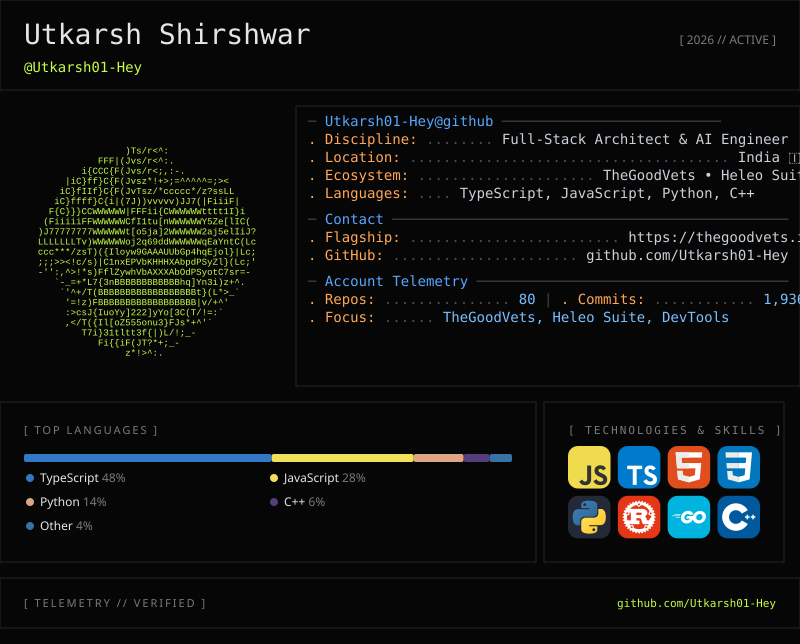

<div align="center">

```ascii
 _   _ _   _              _       ____  _     _           _                         
| | | | |_| |____ _ _ __ | |__   / ___|| |__ (_)_ __ ___| |____      ____ _ _ __  
| | | | __| / / _` | '__|| '_ \  \___ \| '_ \| | '__/ __| '_ \ \ /\ / / _` | '__| 
| |_| | |_|   < (_| | |   | | | |  ___) | | | | | |  \__ \ | | \ V  V / (_| | |    
 \___/ \__|_|\_\__,_|_|   |_| |_| |____/|_| |_|_|_|  |___/_| |_|\_/\_/ \__,_|_|    
```

### `[ SYSTEM OPERATIONAL // APPLIED AI & FULL-STACK ARCHITECT ]`

<p align="center">
  <a href="https://github.com/Utkarsh01-Hey"></a>
  <a href="https://thegoodvets.in"></a>
  <a href="https://www.linkedin.com/in/utkarsh-shirshwar-1a32a9289"></a>
  <a href="mailto:shirshwal44+github@gmail.com"></a>
</p>

<!-- GitAscii Real-Time SVG Telemetry Deck -->
<p align="center">
  
</p>

</div>

---

```
┌─────────────────────────────────────────────────────────────────────────────┐
│ 📟 SYSTEM TELEMETRY // CORE IDENTIFICATION                                 │
├─────────────────────────────────────────────────────────────────────────────┤
│ IDENTITY     : Utkarsh Shirshwar                                            │
│ USERNAME     : @Utkarsh01-Hey                                               │
│ DISCIPLINE   : Full-Stack Architecture • Real-Time Systems • Applied AI     │
│ CORE MOTTO   : "For me, coding is not just a skill — it's a vibe."         │
│ ACTIVE BUILDS: TheGoodVets SaaS EHR • The Heleo AI Suite                     │
│ STATUS       : ACTIVE // DEPLOYING HIGH-PERFORMANCE DIGITAL EXPERIENCES     │
└─────────────────────────────────────────────────────────────────────────────┘
```

---

### 🐾 Featured Flagship: TheGoodVets

```
┌─────────────────────────────────────────────────────────────────────────────┐
│ PRODUCT      : TheGoodVets (Modern SaaS Veterinary EHR Platform)            │
│ LIVE DOMAIN  : https://thegoodvets.in                                       │
│ ROLE         : Founder & Lead Architect                                     │
│ ARCHITECTURE : Multi-Tenant SaaS • Cloud-Native • Mobile-First PWA          │
└─────────────────────────────────────────────────────────────────────────────┘
```

> **TheGoodVets** is an end-to-end, multi-tenant veterinary clinic management and Electronic Health Records (EHR) ecosystem. It bridges the gap between veterinary doctors, clinic receptionists, and pet parents with cloud-native medical charts, appointment scheduling, diagnostic imaging records, and automated vaccination reminders.

- 📋 **Patient & Client CRM**: Centralized health records across multi-pet households, breed specifics, and longitudinal history.
- 💉 **Clinical Treatments & EHR**: Digital consultation workflows, diagnostic finding entries, surgical notes, and automated prescription logs.
- 📱 **Modern Architecture**: Pure dark-mode native UI built with `React`, `TypeScript`, `Node.js`, `Express`, `MongoDB Atlas`, and `TailwindCSS`.

👉 **[Launch TheGoodVets Platform (thegoodvets.in) →](https://thegoodvets.in)**

---

### ⚡ The Heleo Ecosystem

A suite of high-performance tools, creative workflows, and autonomous AI engines engineered for modern developers and creators:

| Module | Purpose & Core Capabilities | Architecture / Tech Stack | Status |
| :--- | :--- | :--- | :---: |
| 🚀 **Heleo Code** | Next-generation terminal AI coding assistant & full-stack orchestrator. Native multi-model discovery & modern file explorer picker. | `TypeScript` • `Bun` • `React/Ink` • `AI SDK` | `STABLE` |
| 🎬 **Heleo Studio** | High-performance browser & native video editor powered by the FilmCraft engine. 1:1 timeline editing, audio mixer, and color scopes. | `React` • `Vite` • `TypeScript` • `TailwindCSS` • `Web Audio` | `STABLE` |
| 🎙️ **Heleo Vox** | Real-time conversational Voice AI assistant & interactive playground with low-latency streaming and dynamic pricing models. | `TypeScript` • `React` • `WebRTC` • `Streaming Audio` | `STABLE` |
| 🔄 **Heleo Sync** | Enterprise omnichannel messaging & Meta Embedded WhatsApp Cloud API onboarding wizard with multi-tenant flow compilers. | `Node.js` • `Express` • `Meta Cloud API` • `MongoDB` | `STABLE` |
| 🤖 **Heleo Mate** | Intelligent desktop companion & contextual AI assistant designed for fluid multitasking and developer acceleration. | `TypeScript` • `Electron / Web` • `Multi-Agent` | `ACTIVE` |
| 🛡️ **Heleo Bot** | Multi-platform autonomous AI automation bot with seamless webhook integrations and asynchronous dispatch. | `Node.js` • `TypeScript` • `Bot Framework` | `ACTIVE` |
| ✍️ **Heleo Scribe** | Automated speech-to-text clinical & meeting documentation engine with real-time speaker diarization and structured summaries. | `Python` • `FastAPI` • `Whisper` • `React` | `ACTIVE` |
| 🎨 **Heleo Design** | AI-native design-to-code workspace & component canvas, translating Figma designs into production-ready UI systems. | `TypeScript` • `React` • `TailwindCSS` • `Figma API` | `ACTIVE` |
| 🗂️ **Heleo Workspace**| Centralized developer orchestration environment with multi-repo project management, contextual memory canvas & agent routing. | `TypeScript` • `Electron` • `React` • `WebSockets` | `ACTIVE` |

---

### 🛠️ Hardware & Software Protocols

<p align="center">
  
  
  
  
  
  
  
  
  
  
</p>

---

<div align="center">

```
"Building isn’t just about writing code — it’s about creating experiences people vibe with."
```

<sub>Engineered with broadsheet terminal aesthetics inspired by <a href="https://github.com/Igorcbraz/GitAscii"><b>GitAscii</b></a>.</sub>

</div>
